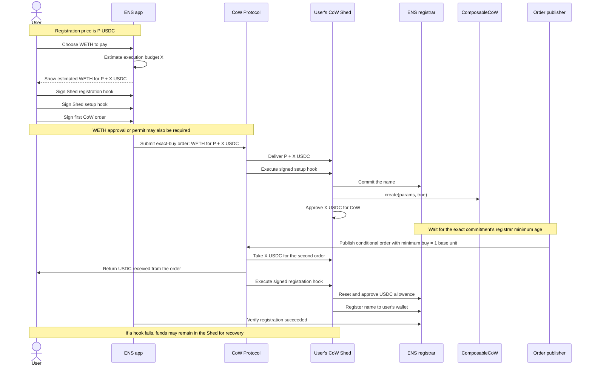
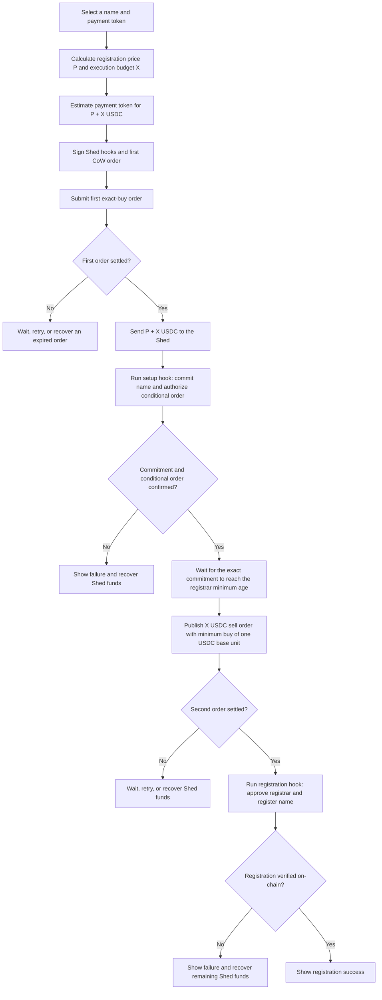

# CoW Shed registration flow experiment

These diagrams show the Sepolia experiment connected to the manager EOA checkout for paying for an ENS registration with a token such as WETH. `P` is the registration price in USDC. `X` is the estimated USDC execution budget for the second order and its hook.

## Sequence

## Process

`X` is the execution budget estimated for the second order and its hook. The quote uses the EIP-1559 maximum fee per gas without a gas-price floor. It prices 2,500,000 gas units with a 2x margin, converts the cost to USDC with upward rounding, and adds one USDC base unit for the minimum return. The total budget has a 1-USDC floor; higher estimates increase it. The first order funds `P + X`. This is an estimate, not a solver fee quote. Settlement can use nearly all of `X`; only the 0.000001-USDC minimum return is guaranteed by the order terms. Existing signed orders keep their original amounts.

The first order expires five minutes after the quote. The second order expires one hour after the first order's expiry. There is no estimated start timestamp: eligibility requires the exact commitment's recorded timestamp plus the registrar's actual minimum age, and ends at its maximum age. The minimum-age boundary is included; the maximum-age boundary is excluded. The order itself remains valid at its signed expiry timestamp. The app checks these conditions again before a missing publication is retried.

The setup hook has a 3,000,000-gas cap for fresh Shed deployment. The quote uses the same cap. Before funding submission, the app simulates the exact saved signed setup hook within its saved gas limit and stops if the call fails. A simulation checks the current state; it does not guarantee later settlement. The setup hook calls `create(params, true)` to authorize the single ENSCommitment order and emit `ConditionalOrderCreated`, then approves exactly X for the vault relayer. It does not remove the conditional order. An identical order keeps the same UID and cannot fill twice. Authorization remains stored, while the handler enforces the signed expiry. Order settlement alone does not prove that registration succeeded; the app verifies the name on-chain.

The handler is deployed on Sepolia at `0x7A383Ef8eaBA234c82a4a7dD20686a6314F41fF1`. Its signed static input is `(address registrar,bytes32 commitment,address sellToken,address buyToken,address receiver,uint256 sellAmount,uint256 minSellBalance,uint256 endTime,bytes32 appData)`. It reads the exact commitment's current timestamp and both registrar age limits, and requires at least `P + X` in the Shed. The order sells X USDC, returns at least one USDC base unit to the wallet, and uses the exact signed registration-hook app-data hash. It fixes zero fee, nonpartial SELL, and ERC20 balance sources. Off-chain input is empty and cannot change the order terms.

The registration hook resets and approves exactly P for the registrar, requires registration to succeed, and revokes both registrar and vault-relayer allowances. Every call is mandatory. A failed registration or revocation reverts the entire hook, including registration, commitment consumption, and the hook nonce. Revocations also roll back on failure, so the earlier bounded setup allowance can remain and needs separate recovery. CoW settlement can still complete even if its post-hook fails; retry must check registration on-chain and must not submit another purchase or spend X again.

Public execution of a signed hook is allowed. Before maturity or without enough registration funds, the registrar rejects the call and the nonce remains unused. If the exact commitment is mature and the Shed already has enough funds, a public caller can complete the signed registration to the intended wallet before the first order settles. This does not prove funding-order completion. The app still tracks the funding order before checking registration, so a consumed commitment can be distinguished from failed setup. A pending funding order can still deliver funds after early registration; remaining Shed funds need recovery. No separate time guard or old handler remains.

The app calls `getTradeableOrderWithSignature` with the required empty proof argument; ComposableCoW checks `singleOrders` for the order hash. The app still publishes the second order and handles an already-published copy of the same order. The event permits external discovery but does not guarantee that an external publisher supports this handler.

Shed funding uses the refreshed quote rather than enforcing the checkout estimate. The submitted order can require more tokens than checkout showed. Trade slippage remains 2% (200 basis points). A token permit uses the fresh initial quote plus a bounded 50% execution reserve; this reserve is authorization headroom, not trade slippage. Later quotes must fit the signed permit. Without a permit, the app ensures exact allowance for the final quote before signing that order. Other payment flows keep their checkout limits.

The signed plan is saved before funding preparation. Funding submission is recorded only after quote validation and token authorization, immediately before the SDK signs and submits the first order. A definite failure before that boundary leaves the attempt prepared: use Back to Quote to confirm a fresh checkout. It does not require payment recovery. An ambiguous first submission requires recovery and cannot start another purchase on retry. A second publication can repeat only the same saved request and order ID. The global resume record stores one latest registration attempt across wallets and names. Required saves verify that storage retained the record before submission can continue. A later attempt can replace the app's saved access to an earlier signed plan. A new registration does not wait for earlier hook deadlines. Earlier signed hooks remain valid until their deadlines and can still execute against the same Shed. The app links to CoW Swap for funds recovery; it does not withdraw funds itself. Moving funds out of the Shed does not cancel signed hooks.

Resume keeps the registration price from the signed plan instead of replacing it with a new quote. A failed attempt keeps its payment checkpoint and restores the failure screen after reload. If the commitment has expired, the app shows recovery details without restarting the attempt or offering Try Again. It checks expiry again before retrying a restored failure.

Only the current ENSCommitment plan format can resume. Old experimental signed plans are not migrated, rebuilt, or retried, and browser storage is not cleared by this change. Their signatures and any funds on-chain are unaffected by removing app support.

## Wallet requests

The checkout button names the current wallet request and explains what it authorizes. Completed-request history is not shown. This status is transient; the signed plan and payment checkpoints remain the recovery source of truth. The registration screen shows the current stage without a milestone checklist.

1. Sign the registration hook. This authorizes the Account Proxy to approve the registrar for the name price, register the name to the selected owner, and clear the registrar and CoW allowances. It is an off-chain signature and does not send a transaction.
2. Sign the setup hook. This authorizes the Account Proxy to commit the name, authorize the conditional registration order, and approve its execution budget for CoW. It is also an off-chain signature.
3. Authorize and submit the payment. Native ETH uses an EthFlow transaction, which spends ETH and requires wallet gas. ERC-20 payment can require a token permit signature or an on-chain approval before the CoW order signature. Tokens that require a zero allowance first can need a reset transaction followed by an approval transaction. An existing sufficient allowance skips these requests. A refreshed quote can require another approval.

The CoW SDK combines payment-order signing and submission, so the app shows this as one step until submission succeeds. An approval transaction remains in progress until its receipt succeeds. A cancelled or failed request is never marked complete. The later conditional registration order is published from the saved authorization and does not ask for another wallet signature. These signatures authorize future execution; closing the checkout or rejecting a later prompt does not cancel hooks that were already signed.

## Local hook verification

From `packages/transaction-manager`, run `pnpm exec vitest run --config src/test-utils/cow-shed/vitest.evm.config.ts` with Forge and solc 0.8.25 installed. This separate test runs offline. It uses the generated app calls and pinned Sepolia factory and implementation bytecode to create the real compatible Shed proxy and check public execution, signatures, nonce preservation, expiry, replay rejection, and registration/allowance rollback. Runtime addresses, block, hashes, and source reference are in `src/test-utils/cow-shed/sepolia-runtime.json`. The registrar, USDC, and ComposableCoW are stateful test doubles; this verifies Shed execution, not live settlement or the full deployed registration flow.

## Live verification

Same-token settlement and registration succeeded on Sepolia in the preceding experiment. The new handler and mandatory registration hook still need live end-to-end verification with the user performing wallet actions. The execution budget is a conservative estimate, not a gas simulation. Support for this Shed factory on the external CoW recovery page has not been verified.
